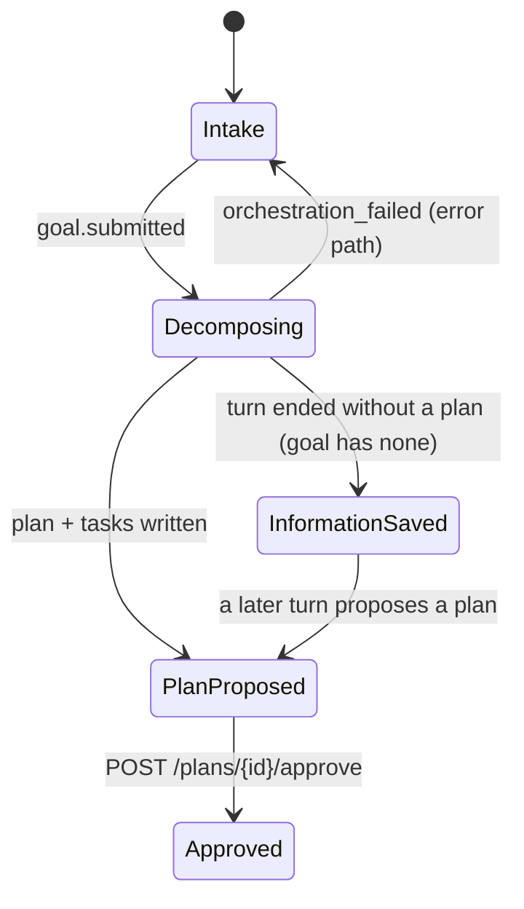

# ADR-0036: Goal status `InformationSaved` for turns that need no plan

**Status:** Accepted (2026-11-23, project owner) and built the same day. The owner chose the name
`InformationSaved` (instead of the first suggestion, `AwaitingGardener`) and approved one
status for both "noted" and "asked a question" (§2).
**Date:** 2026-11-23
**Deciders:** Project owner / lead engineer
**Stories:** CP-08 / CP-03 follow-up (check-in and tracking goals). Amends the goal lifecycle in
`architecture.md` §7.3.

## Context

**What happened in `dev` on 2026-11-23 (garden "Coconut Baug"):** the owner submitted two goals for
palm #13, "Initial check in" and "Initial check in. See if any issues.", each with a photo. Both
orchestrator turns succeeded: the stake was read as #13 and the reply diagnosed underwatering. But
the model returned **no plan**, so both goals stayed in **`Decomposing`** and looked stuck.

**Why:**

- `handle_goal_submitted` sets `Decomposing`, and only a turn that returns a plan moves the goal on
  (`PlanProposed`). A turn without a plan leaves the status unchanged.
- The orchestrator's prompt has always allowed a turn without a plan ("ask one clarifying question …
  it's fine not to propose a plan on this turn"). Nothing in the lifecycle covered that outcome.
- In one goal, the model wrote numbered steps into the reply instead of the plan. That part is fixed
  separately: a prompt and schema rule now says steps the reply recommends must be in the plan.
- **Many goals legitimately need no plan.** Since ADR-0034/0035, a goal is also how the gardener
  checks on a palm. A photo of #13 with "initial check in" is filed to #13's history, and the useful
  outcome is "noted, looks fine" (or a question), not a task list to approve.

`architecture.md` §7.3 lists exactly four statuses the code writes (`Intake`, `Decomposing`,
`PlanProposed`, `Approved`), and the frontend groups goals by them. Adding a value changes that
public contract, so this ADR is required.

## Decision

### 1. A fifth goal status: `InformationSaved`

When an orchestrator turn ends **without a plan** and the goal **has no plan yet**, the orchestrator
sets the goal to `InformationSaved`. It means: Tendril has read and recorded what you shared, and
there is nothing to approve.

What was recorded:

- the reply in the chat;
- the photo, linked to its plant;
- the plant-history entry (ADR-0035).

**Rules:**

- **Only for a goal without a plan.** A goal that already has a plan keeps its status
  (`PlanProposed` / `Approved`) on a turn that doesn't revise it, as today.
- **Applies to every turn type:** goal intake and chat messages. A chat turn on a goal still in
  `Decomposing` (like the two in dev) also resolves to `InformationSaved` when it ends without a
  plan.
- **Leaving it:** `InformationSaved` is not final. Any later turn that proposes a plan moves the goal
  to `PlanProposed`. Asking "please make a plan" in the chat is enough.
- **Proposals are unaffected:** confirm/reject (ADR-0034) don't depend on goal status.

### 2. A clarifying question is also `InformationSaved`

A turn that ends with a question ("Is the drip running daily?") also has no plan. It gets the same
status, and the question is visible in the chat. One status keeps the lifecycle simple. A separate
"waiting for you" state is deferred (see Options).

### 3. Contract and UI

- **OpenAPI:** `Goal.status` stays a string; its description lists the five values. It is not a
  closed enum, so older clients don't break on a new value.
- **Frontend:**
  - the goal card and goal page show `InformationSaved` as **"Saved"** (neutral tone);
  - the Home screen counts it neither as "needs approval" nor "in progress";
  - the goal page's chat stays open, so the gardener can still ask for a plan.
- **Docs:** `architecture.md` §7.3 diagram and the "only four statuses" note become five.

## Options Considered

| Option | Effect | Verdict |
|---|---|---|
| **A. `InformationSaved` for every no-plan turn on a goal without a plan (chosen; owner's naming)** | Goals never look stuck; check-in/tracking goals end in an honest state | **Chosen** |
| B. `AwaitingGardener` | Accurate for questions, misleading for "noted, all fine" check-ins | Rejected by the owner in favour of A |
| C. Two statuses: `InformationSaved` (nothing needed) + `AwaitingGardener` (question asked) | Most precise; the model must also report which case it is (a new structured field), and the UI needs two presentations | Deferred: revisit if questions get lost among saved check-ins |
| D. Always force a plan at intake (fallback plan from the reply) | Every goal reaches `PlanProposed` | Rejected: invents task lists for check-ins and removes the "ask first" option |
| E. Leave `Decomposing` | No contract change | Rejected: goals look stuck forever |

## Consequences

- **Easier:** check-in and tracking goals finish cleanly; "stuck in Decomposing" now only means a
  turn is genuinely running or has failed.
- **Harder:** one more status for the frontend to present and for future lifecycle work (`Completed`
  is still an open gap; `InformationSaved` is not a completion signal).
- **Existing data:** the two `dev` goals stuck in `Decomposing` resolve on their next chat turn. A
  one-off update is not needed.
- **ADR-0034/0035:** unchanged; their proposals and history writes don't read goal status.

## Action Items

Build notes: `GOAL_INFORMATION_SAVED` in `app/orchestrator/orchestrator.py` (`_apply_turn_result` checks
for an existing `PLAN#` item). Separately, the orchestrator's prompt and its `updated_plan` field now
require that steps the reply recommends are returned as plan tasks, which fixes the numbered-steps-in-text
case. Frontend presentation lives in `shared/components/goal-status.util.ts`.

**Follow-up fix (2026-11-23, plant #50 in dev):** the structured plan call hit
`MaxTokensReachedException` (no output budget was set). The old PA-01 fallback then wrapped the
model's raw reasoning into a one-task plan, which is option D in practice. Now:

- a structuring failure relays the reply without a plan, so the goal becomes `InformationSaved`;
- the orchestrator model has an explicit `max_tokens` of 8192 (accepted by
  `global.amazon.nova-2-lite-v1:0`; overridable with `ORCHESTRATOR_MAX_TOKENS`);
- the prompt tells the model never to narrate its own reasoning in the reply.

**Second follow-up (2026-11-23, plant #8 in dev):**

- **The goal became `InformationSaved` although the reply listed steps.** Nova 2 Lite wrote "updated_plan with tasks: …"
  in its own notes, yet returned no plan, because the plan was an optional nested field. The
  structured-output schema is now `TurnOutput`, with a **required** `outcome` (`plan` | `question` |
  `noted`) and **required** `success_criteria` and `tasks`. Only `outcome: plan` with tasks becomes a
  plan. Two live runs of the #8 scenario both returned a 3-task plan.
- **Saved goals disappeared from Home.** They now have their own short "Saved" section (§3
  amended); they still don't count as needing attention or as in progress.

1. [x] Human review: approved 2026-11-23.
2. [x] Orchestrator: set `InformationSaved` in `_apply_turn_result` when a turn has no plan and the
   goal has none; tests for intake, chat and the existing-plan case.
3. [x] OpenAPI `Goal.status` description; frontend presentation ("Saved", Home grouping).
4. [x] Docs: `architecture.md` §7.3 diagram and status note; data-architecture Goal row.
5. [ ] Dev verification (pending deploy): a "check in" goal with a #13 photo ends as "Saved" with the photo in #13's
   history.
