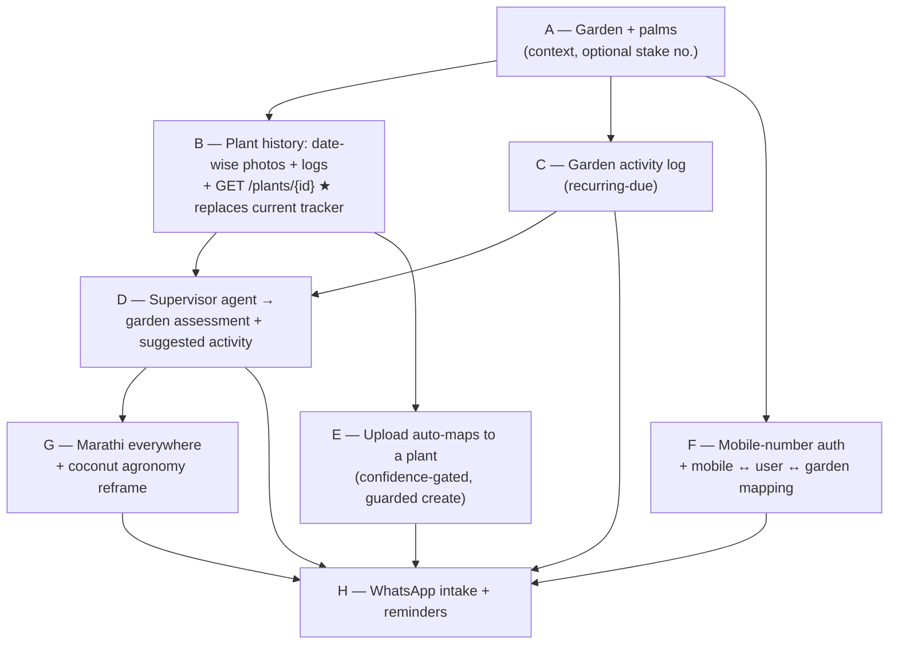

# Tendril → Coconut Plantation — Migration & Extension Roadmap

**Status:** Proposed (2026-11-19), revised after owner review (2026-11-23), current sprint
**Driver:** Move the Bramhangaon coconut tracking off its current ad-hoc tool (a hand-maintained
HTML tracker with per-plant photo folders) onto Tendril as a **single Garden holding all 105
palms**. The spine is a dead-simple, task-and-goal-oriented loop: **anyone (Anil or the owner)
uploads a photo → it is auto-mapped to the right palm → the agents review it, propose tasks, the
owner accepts → reminders go out automatically on WhatsApp — all communicated in Marathi.**
Intercropping, irrigation and other whole-farm facts are captured as **Garden-level context**,
not as a separate crop model.

This document sequences the work. It does not replace the story files or ADRs; it says what we
build, in what order, and what "done" means — the same contract as [`roadmap.md`](./roadmap.md).
**The story file [`stories/coconut-plantation.md`](./stories/coconut-plantation.md) (CP-01..CP-11)
and its rank order in [`backlog.md`](./backlog.md) are authoritative;** this roadmap gives the
rationale and is kept consistent with them.

**Owner decisions (2026-11-23):**
1. **Stake number is optional**: the farm's own physical label, unique *within a garden* when
   present, never generated by Tendril. `plant_id` stays the internal identity.
2. **Date-wise photos and logs are kept as history** per plant (append-only).
3. **A dedicated plant endpoint**: `GET /gardens/{gardenId}/plants/{plantId}`.
4. **Memory is scoped per garden** (`garden:{garden_id}`), shared by the garden's team. Auth
   does not change this.
5. **WhatsApp comes after authentication + mobile-number mapping.**
6. **A new Supervisor agent** sits above the orchestrator, recorded as an architecture candidate.

---

## 1. The real-world project we are onboarding

| Fact | Value |
|---|---|
| Site | Bramhangaon Farm, Tal. Kopargaon, Dist. Ahilyanagar, Maharashtra (~19.9552, 74.4491) |
| Main crop | 105 × **Kalpa Samrudhi** D×T hybrid coconut, planted ~10 Sep 2026, 25×25 ft square, 1.5 acre west block |
| Secondary planting | 23 × **Tall** variety coconut along the eastern fence (tracked separately, not in the 105) |
| Intercrop | Vegetable garden (brinjal, marigold) occupying ~3-palm band near the north edge; **chana (chickpea)** planned as rabi intercrop in the 25×25 alleys; ground cover kept as living mulch — all captured as **Garden-level context**, not separately tracked (for now) |
| Irrigation | 16 mm drip off well water; emitter placement ~1.5 ft off collar |
| Soil | Heavy black clay, calcareous/saline — recurring lime-locked Fe/Mg/N chlorosis; surface salt efflorescence |
| Operations | Owner (Prashant) + field worker (Anil), team-run; numbered wooden stakes tag each palm |
| Current state of record | Per-plant dated photo archive + dated notes + a published health tracker; 102 of 105 palms logged (132 photos over 20 dates, as of 22 Nov 2026), inputs log (humic 23 Oct, foliar spray 15 Nov, jivamrut planned) |

The thing we are replacing is good at exactly one thing — a **dated, per-plant photo-and-note
timeline** — and weak at everything else (no reasoning, no follow-up, no multi-crop model, no
auth, 16 MB page ceiling). Tendril is strong at everything else and currently weak at *that one
thing*. The roadmap is largely about closing that single gap and adding the plantation concepts
Tendril's garden model never needed.

---

## 2. Fit assessment — what Tendril already gives us

### 2.1 Maps cleanly, reuse unchanged

| Coconut need | Tendril construct | Notes |
|---|---|---|
| The farm as a project | **Garden** (`GARDEN#{id}`) | One Coconut Project = one Garden, with `geolocation`, `vision`, `climate_zone`. |
| Each numbered palm | **Plant** (`PLANT#{id}`) | 105 Plants under the one Garden; `species`/`variety` already exist. Missing: an optional `stake_no` (CP-02), and `stage` is hardcoded to `"new"` on create. |
| Dated photos | **Media** (`MEDIA#{id}`) | Already linkable to Plant / Goal / Task; S3-backed, presigned on read. Keyed by random id, so there's no dated per-plant query yet (§3.3). |
| A health concern / wish | **Goal → Plan → Task** | "Lower-leaf yellowing on #74" → diagnosis → plan → tasks, exactly the current notes-to-action flow. |
| **Farm-level vs plant-level activity** | **`Task.scope ∈ {garden, plant}`** | **Already modelled.** "Spray the whole block" is a garden-scope task; "trim #63's dried frond" is plant-scope. This is the single most important pre-existing fit. |
| Specialist agronomy | **5 agents**: vision, agronomy, irrigation, pest/disease, pruning | Directly on-point for coconut: chlorosis (agronomy), drip/waterlogging (irrigation), leaf-spot (pest/disease). |
| Per-plot institutional memory | **Bedrock Knowledge Base, `scope = garden:{garden_id}`** | "What worked on this block last season" accrues automatically. Per garden, shared by the whole team. |
| Proactive follow-up | **Tracker/Scheduler Lambda + `TasksDueIndex`** | Overdue-inspection nudges and recurring-input reminders ride this unchanged. |
| Activity feed | **Event** log | The inputs/applications log (humic, spray, jivamrut) is an Event stream. |

### 2.2 Gaps Tendril has today (confirmed from its own docs/backlog)

1. **No auto-map of a photo to a plant.** Today a photo is attached to a plant the user has
   already selected/created by hand. Our flow needs the **upload itself to decide** which palm it
   belongs to (and when to create one) — see §3.2.
2. **No per-plant history.** A Task supports exactly **one** check-in photo, and the data
   doc states plainly a real progress *log* is "still carried-forward work." Our core need —
   a date-wise history of photos **and** log entries per palm, with a before/after view — **does
   not exist yet**. (`roadmap.md` Phase 8+, `data-architecture.md` §2 Task note.)
3. **No push channel.** No WhatsApp/SMS/web-push — follow-ups are in-app poll only (architecture
   §1, ADR-0004). WhatsApp is both our intake and our reminder channel, so this is central, not
   optional. It is built **after** auth (gap 4), because an inbound sender must resolve to a
   known user and garden.
4. **No auth.** `USER` is an anonymous `X-User-Id` header; Cognito is carried-forward. We need
   **mobile-number login** with garden-level access (full now, read/write granularity later) and
   a **mobile-number ↔ user ↔ garden mapping**, which WhatsApp then depends on.
5. **Single-plant flows, not plantation scale.** Onboarding is one-plant-at-a-time; there is no
   bulk add, no block/grid view over 105 palms, and no single-plant read endpoint (only `DELETE`
   exists on `/plants/{plantId}`).
6. **Garden/amateur framing, English-only.** Project context §11 lists commercial farms as a
   *non-goal*; prompts and guardrails are hobby-garden-flavored and English-only. We need
   commercial-coconut, calcareous-soil-aware prompts, and **every message mirrored in Marathi**.
7. **No garden context reaches the agents.** The orchestrator passes specialists only the prompt,
   `gardenId` and an optional image; no garden facts (vision, location, soil) are injected.
8. **No garden-level reasoning loop.** Nothing assesses the whole garden on its own schedule;
   every reasoning turn starts from a user-submitted goal. This is what the new **Supervisor**
   agent (§3.4) adds.

**Deliberately NOT a gap we are closing:** a multi-crop / zone model. Intercropping, irrigation
layout and ground cover are captured as **Garden-level context** the agents read, not as separate
tracked entities. This is the single biggest simplification versus a plantation-grade model, and
it is the right call until the chana or vegetable plots need tracking in their own right (see §7).

None of these is an architectural blocker — the factory/registry/externalized-prompt design is
exactly what lets us extend without forking the engine.

---

## 3. Domain-model changes (kept deliberately small)

No new top-level entity (no Crop, no Zone). The changes are additive attributes and one new
access pattern on the existing single-table design in
[`data-architecture.md`](./architecture/data-architecture.md). Each still warrants an ADR (§6),
but the surface area is far smaller than a plantation-grade model.

### 3.0 Two layers: a plant history under a garden activity layer

The real shape of this operation, confirmed from a season of data, is two layers with different
jobs — and almost all the *action* is at the top:

- **Plant layer — inspection / assessment log (read-mostly).** Each palm accumulates dated photos
  and a health status over time. There is essentially **no plant-specific activity** — we don't
  fertilize or treat one palm; we inspect it and record how it's doing. So at the plant level the
  system mostly *captures and assesses*, it does not task.
- **Garden layer — assessment + activity log (where the work is).** Every real intervention is
  garden-wide: humic acid, jivamrut, the foliar spray, deep leaching, block weeding. The system's
  job here is to (1) **roll up** the plant inspections into an **overall garden state**, (2)
  **suggest garden-level activities**, (3) let the owner accept, and (4) **track them to done**
  with reminders. This layer sits *on top of* the plant layer and is driven by it.

Tendril already carries both: `Task.scope ∈ {garden, plant}` and garden-scoped Goals give
garden-level tasks for free, and the garden-level `Event` log is the activity history. The only
genuinely new capability is the **garden-state assessment** (3.4), owned by a new **Supervisor**
agent: reasoning across many plant histories to a single block-level verdict and a suggested
activity. The per-plant history (3.3) feeds it; the garden activity log (3.3) records what gets
done.

### 3.1 Garden-level context carries intercropping, irrigation, soil

The Garden entity already has `vision`, `geolocation`, `climate_zone`. Add a structured
**`context`** block (JSON) for the whole-farm facts the agents must reason with but that are not
separately tracked:

- intercrop plan (vegetable strip, chana in the alleys, living-mulch ground cover),
- irrigation layout (16 mm drip, emitter ~1.5 ft off collar, well source),
- soil profile (heavy black calcareous/saline clay, lime-locked Fe/Mg/N, surface salt),
- spacing/layout (25×25 ft square, 1.5 acre west block, 23 Tall on the east fence),
- optional **stake-number range** (e.g. main block 1–105), so bulk-add (Phase A) and auto-map
  (Phase E) read the valid range from the garden instead of a hardcoded 105,
- **notification recipients** — the WhatsApp mobile number(s) this Garden's reminders go to
  (e.g. owner + field worker), each with a name and in E.164 format. A Garden can notify **several
  numbers**. They are captured in Phase A, linked to logged-in users in Phase F (auth +
  mobile-number mapping), and messaged in Phase H (WhatsApp).

Today **no** garden context reaches the specialists (gap 7). Phase A therefore also injects this
block into the orchestrator's turn and the specialist payload, making the coconut-specific facts
first-class input. When intercropping later needs its *own* tracking, that is the moment to
revisit a Crop entity — not now.

### 3.2 Auto-map on upload (the new front door)

The upload decides the plant; there is no manual "Add Plant" on the happy path.

The stake number is **optional** (decision 1): it is the farm's own label, unique within the
garden when present. Auto-map works only for plants that have one.

1. Photo arrives (in the app; later on WhatsApp, Phase H) → **vision reads the stake number** and
   matches it against the garden's existing plants' `stake_no`.
2. **High confidence + matches an existing plant** → auto-file to that Plant's history. No prompt.
3. **Low confidence, ambiguous, or no readable stake** → one-tap confirm ("Is this #71 or #7?")
   or pick the plant by hand before filing. Plants without a stake number are always picked.
4. **Reads outside the garden's stake range (§3.1), or clearly a new planting** → offer to
   **create** a new Plant, and flag it — never silently, because with a fixed set of 105 a new
   number is more often a misread of an existing tag than a real new palm. Auto-create is the
   guarded exception, auto-map is the rule.

This reconciles "no manual Add Plant when confidence is high" with the current tracker's hard-won
lesson that an unconfirmed OCR read must never *assign identity* on its own. The guard protects
the integrity of every palm's history; the automation keeps the field flow one-tap.

### 3.3 Plant history + Garden activity log (the carried-forward gap, built)

- **Plant history (date-wise photos + logs):** each Plant keeps an **append-only, date-wise
  history**. An entry is dated by its observation date (never upload time) and holds any of: one
  or more photos, a status (`healthy|ok|watch`), a note. A log with no photo is valid. This is the
  per-plant timeline the current tracker is built around, independent of Task check-ins. New
  access pattern: list a Plant's history by date without a scan (e.g. sk
  `PLANTLOG#{plant_id}#{date}#{entry_id}`, decided in ADR); the latest status/photo is
  denormalized onto the Plant. Corrections (moving a misfiled photo) are recorded, never silent
  rewrites. This is `tracker-scheduler.md`'s carried-forward "repeated-check-in progress log,"
  now made a real entity rather than a single `Task.media_id`.
- **Plant endpoint:** `GET /gardens/{gardenId}/plants/{plantId}` returns the plant's details
  (incl. optional `stakeNo`, latest status) plus its paginated history with presigned photo
  URLs; a "compare" view pairs the newest shot with an earlier one.
- **Garden activity log (the primary action record):** a dated log of garden-wide interventions —
  humic drench (23 Oct), the foliar spray (neem oil 40 ml + Dhartivita 10 g + sticker 5 ml, 2
  pumps, 15 Nov), jivamrut (planned), leaching, block weeding. Each is a garden-scoped **Task**
  (proposed → accepted → done) plus a typed **Event** (`input.applied` / `activity.done`) on the
  garden timeline. For recurring activities, a **due-date rule** on the existing
  Tracker/`TasksDueIndex` nudges the next one (e.g. humic every 3–4 weeks). This is also what the
  agents read before advising ("you already sprayed 4 days ago"). No scope widening needed —
  `Task.scope = garden` already covers it; the gap is a first-class **activity log view** and the
  recurring-due rule, not a new entity.

### 3.4 Garden-state assessment + Supervisor agent (the one new capability)

The genuinely new piece, and a **new agent**: the **Supervisor**, recorded as an architecture
candidate in [`architecture.md`](./architecture/architecture.md) §3 until its ADR is accepted.

1. A **deterministic rollup** (plain code, model-free, Tracker-style) reads across the **plant
   histories** (3.3) — how many palms are healthy / ok / watch, which symptoms recur — plus the
   Garden context (3.1) and the recent activity log, into a compact garden-state summary.
2. The **Supervisor** runs on its own schedule (EventBridge) with an agenda of standing checks,
   owns the garden's standing goals, and consumes that rollup.
3. When it decides to act, it **submits a garden-scoped goal into the existing orchestrator**,
   which composes specialists as it does today. The orchestrator is not replaced.
4. The result is a single **block-level assessment** plus a **suggested garden activity**
   ("widespread lower-leaf chlorosis on ~20 palms → apply Mg foliar + keep jivamrut schedule").
   The owner accepts, and it becomes a tracked garden activity (3.3) with reminders (in-app now,
   WhatsApp from Phase H).

The ADR decides whether the assessment reasoning lives in the Supervisor or in a new garden-level
specialist (registry entry, no new agent code), and names the model choice. This is the "assess
overall garden state, suggest and track activities" layer, and it is what makes the tool more
than a photo log: the plant layer feeds it, the garden activity log records its output.

---

## 4. Phased roadmap

Same "one demoable vertical slice at a time" discipline as [`roadmap.md`](./roadmap.md). The
sequence follows the spine: **onboard → plant history → garden activity → Supervisor assessment →
upload-and-auto-map → auth + mobile mapping → Marathi → WhatsApp.** Phases map one-to-one onto the
story ranks in [`stories/coconut-plantation.md`](./stories/coconut-plantation.md). Build in order;
each phase must be live-verified in `dev` before the next.

| Phase | Stories | Slice | What ships | New ADR? | Depends on |
|---|---|---|---|---|---|
| **A** | CP-01, CP-02 | **Onboard the Garden + palms** | Create the Bramhangaon Garden with the §3.1 **context** block (intercrop, irrigation, soil, layout, optional stake range, **notification recipients**), injected into the orchestrator and specialist calls; **bulk-add Plants #1–105** with variety/stage and an **optional, per-garden-unique stake number**; the 23 Tall flagged as border. A block/grid list ordered by stake number. | **Yes** — Garden `context` block | Tendril Phases 1–2 (done) |
| **B** | CP-03, CP-04, CP-05 | **Plant history + migration + plant endpoint** | Append-only **date-wise photos + logs** per palm; `GET /gardens/{id}/plants/{plantId}` (details + paginated history); plant-detail screen with timeline and before→after compare. Migrate the existing archive (§5). **Highest-value slice — it replaces the current tracker.** | **Yes** — Plant history entity + read contract (§3.3) | A |
| **C** | CP-06 | **Garden activity log** | Garden-scoped Tasks + typed Events as the primary action record; recurring-due rules on the Tracker (e.g. humic every 3–4 weeks); an activity-log view of past + upcoming activities. | **Yes** — garden activity log | A |
| **D** | CP-07 | **Supervisor + garden-state assessment** | New **Supervisor** agent (§3.4): deterministic rollup → scheduled assessment → suggests a **garden-wide activity** with a "done when" → submits it via the orchestrator → owner accepts in one tap → tracked on the activity log (C). Simple, task-oriented UI. | **Yes** — Supervisor agent + assessment | B, C |
| **E** | CP-08 | **Upload → auto-map to a plant** | The §3.2 front door in the app: vision reads the stake number, confident match auto-files to that plant's history, low confidence → one-tap confirm, out-of-range → guarded flagged create, plus a "move this photo" correction. | **Yes** — plant-identity / auto-map policy | B |
| **F** | CP-11 | **Mobile-number auth + mapping** | Cognito **mobile-number (OTP) login**; garden-level access = full for now; **mobile-number ↔ user ↔ garden mapping**; notification recipients linked to users. Memory scope stays per garden. | **Yes** — auth/tenancy | A |
| **G** | CP-10 | **Marathi on everything + coconut agronomy** | Every message mirrored in **Marathi** (reviews, tasks, reminders, UI); reframe the 5 specialist prompts + guardrails for **commercial coconut on calcareous/saline clay** (chlorosis, salt leaching, drip placement, leaf-spot, organic-first). Revisit the §11 commercial non-goal. | **Yes** — commercial-scope + localization | D |
| **H** | CP-09 | **WhatsApp intake + reminders** | Photo in on WhatsApp from a **mapped number** (F) → E's auto-map files it; C/D's accepted activities, overdue nudges and suggestions go **out** on WhatsApp to the Garden's linked recipients, in Marathi (G). Unmapped senders are rejected. Closes the no-push-channel gap; this is Anil's actual channel. | **Yes** — notification/reply channel (extends ADR-0004) | C, D, E, **F** |

**Suggested MVP cut (fastest useful replacement):** **A + B + C** (CP-01 → CP-06). That gives a
real replacement for today's tracker — every palm, its date-wise photo and log history, the plant
endpoint, and a tracked garden activity log — all in-app. **Demo-complete** (usable by Anil in the
field): **+ D (Supervisor), E (auto-map), F (auth + mobile mapping), G (Marathi)**, then **H
(WhatsApp)**, which deliberately waits for F so every inbound WhatsApp sender resolves to a known
user and garden.

---

## 5. Data migration (from the current archive)

The source of truth today is the per-plant archive plus the generator script:

- `Coconut Tracking/<NN>/<YYYY-MM-DD>[_HHMM]_plant<NN>.jpg` — dated photos per palm (132 across 102
  palms; two filename shapes, see CP-04).
- `build_tracker.py` — holds every plant's dated note as `P[plant] = [(date, status, en, mr), …]`
  and the inputs log.
- Memory notes — status history, the OCR-unreliability lesson, border-Tall exclusion.

Migration is a one-off script (Phase B, CP-04):

1. **Garden + Plants:** create the Garden; create Plants #1–105 with their stake numbers taken from
   the archive folder names (+ the 23 Tall as `border` crop).
2. **Photos → plant history:** upload each `<date>[_HHMM]_plant<NN>.jpg` to `MediaBucket` and write
   a plant-history entry (§3.3) with the **date parsed from the filename** (not upload time) so the
   timeline is historically correct.
3. **Notes → plant history / Goals:** replay each `(date, status, note)` as a dated history log
   entry on the plant (+ a garden Event); promote any `watch`-status note to a Goal so the agent
   can pick up open concerns (e.g. #74 chlorosis, #63 dried frond).
4. **Inputs log → Events:** humic 23 Oct, foliar spray 15 Nov, jivamrut (when applied) as
   `input.applied` Events at the right scope.
5. **KB seed:** ingest the farm context, inputs log and per-plant history summaries into Garden
   Memory, scope `garden:{garden_id}`.
6. **Verify:** per-plant photo counts and latest status match the current published tracker before
   cut-over; keep the archive as the backup of record until parity is signed off.

No re-reading of stake numbers is needed — identities are already human-verified in the archive
folder names, which is precisely the discipline Phase E (auto-map) enforces going forward.

---

## 6. Decisions that need an ADR before building

Per CLAUDE.md, each architecturally significant change stops for a human-approved ADR. This work
raises at least:

In build order (next free ADR number: **0016**):

1. **Garden `context` block** (structured whole-farm facts the agents read, optional stake range, notification recipients; injected into orchestrator + specialists) — Phase A.
2. **Plant history entity + read contract** (date-wise photos + logs, append-only; optional per-garden `stake_no`; `GET /plants/{plantId}` with pagination) — Phase B.
3. **Garden activity log** (garden-scoped Tasks/Events as the primary action record, recurring-due rules) — Phase C.
4. **Supervisor agent + garden-state assessment** (new agent above the orchestrator; deterministic rollup; scheduled agenda; submits garden-scoped goals to the orchestrator; model choice) — Phase D.
5. **Plant-identity / auto-map policy** (confidence-gated auto-file on a stake-number match; one-tap confirm on doubt; guarded auto-create outside the garden's stake range; vision never silently assigns identity) — Phase E.
6. **Auth/tenancy** (Cognito mobile-number, mobile ↔ user ↔ garden mapping, garden-level access now, read/write granularity later; memory stays per garden) — Phase F.
7. **Commercial-scope + localization** (revisit §11 non-goal; Marathi on all comms) — Phase G.
8. **Notification/reply channel** (WhatsApp; extends ADR-0004's deferred push channel; supersedes the backlog's 2026-09-12 WhatsApp deprioritization; requires F's mapping) — Phase H.

Deliberately **not** raised: a Crop/Zone model. If intercrop tracking is taken up later, it gets
its own ADR at that point.

---

## 7. Risks, watch-items, non-goals

- **Scale of Media.** 105 palms × weekly photos × a season is thousands of objects — fine for S3,
  but the timeline/compare queries and any thumbnail generation need to be designed for it (don't
  repeat the 16 MB single-page ceiling that the current tracker is hitting).
- **Auto-map is the integrity risk, now that it is automatic.** A high-confidence misread files a
  photo onto the wrong palm silently, and a bad auto-create spawns a phantom palm. The §3.2 guards
  (confidence threshold, one-tap confirm, auto-create only outside the garden's stake range and
  always flagged) are the data-integrity control — Phase E is not optional polish. Keep a cheap
  "move this photo to #NN" correction so a rare misfile is one tap to fix, not a silent corruption.
- **Supervisor autonomy.** A scheduled agent that proposes work on its own can become noisy. It
  only *suggests* garden activities (owner accepts), and it acts through the existing
  orchestrator, so the HITL accept step stays in place.
- **WhatsApp sender identity.** Inbound WhatsApp is only safe once every sender maps to a known
  user and garden — which is why Phase H waits for Phase F.
- **Intercropping is context, not tracking — by choice.** Capturing it as Garden-level context
  (§3.1) means the agents can *reason* about chana N-fixation or the veg strip, but we do not
  *track* those crops (their own tasks, yield, history). If that need appears, it is a Crop entity
  and its own ADR, not a patch.
- **Commercial non-goal.** Onboarding a 1.5-acre plantation deliberately crosses Tendril's stated
  amateur-garden scope (§11). That is a product decision to make explicitly (Phase G ADR), not to
  drift into.
- **Still a non-goal:** marketplace/e-commerce, IoT actuation (ADR-0015 remains Proposed), and the
  cross-user data flywheel (capture-first now; aggregation later).

---

## 8. Related documents

- [`roadmap.md`](./roadmap.md) — the base Tendril roadmap this extends.
- [`project-context.md`](./project-context.md) — concept/vision, personas, the §11 non-goals this revisits.
- [`architecture/architecture.md`](./architecture/architecture.md) and
  [`architecture/data-architecture.md`](./architecture/data-architecture.md) — the model every phase writes against.
- [`architecture/ADRs/`](./architecture/ADRs/) — binding decisions; §6 lists the new ones this work needs.
- [`stories/tracker-scheduler.md`](./stories/tracker-scheduler.md) — where the carried-forward progress-log gap (now Phase B's plant history) is first noted.
- [`stories/coconut-plantation.md`](./stories/coconut-plantation.md) — the CP-01..CP-11 stories (authoritative scope + rank).
- [`backlog.md`](./backlog.md) — CP epic at ranks 38-48.
