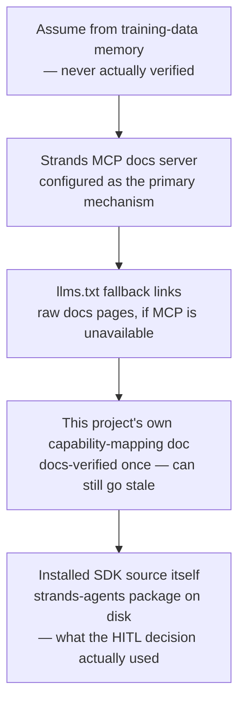
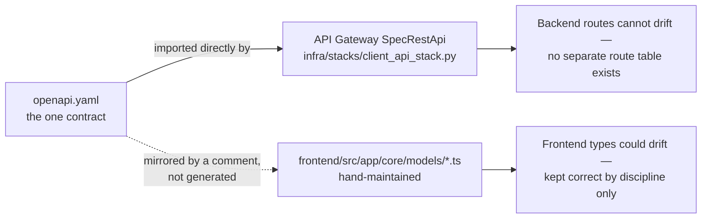
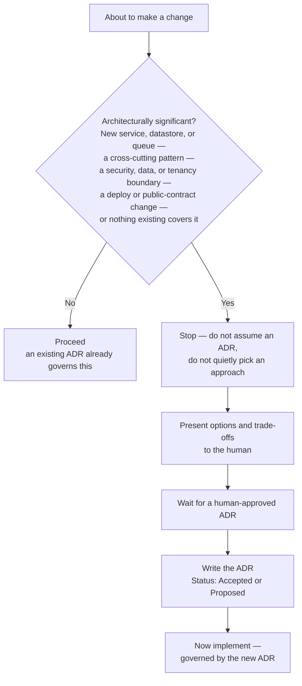
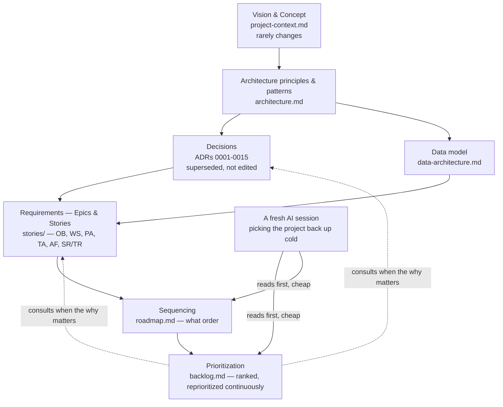
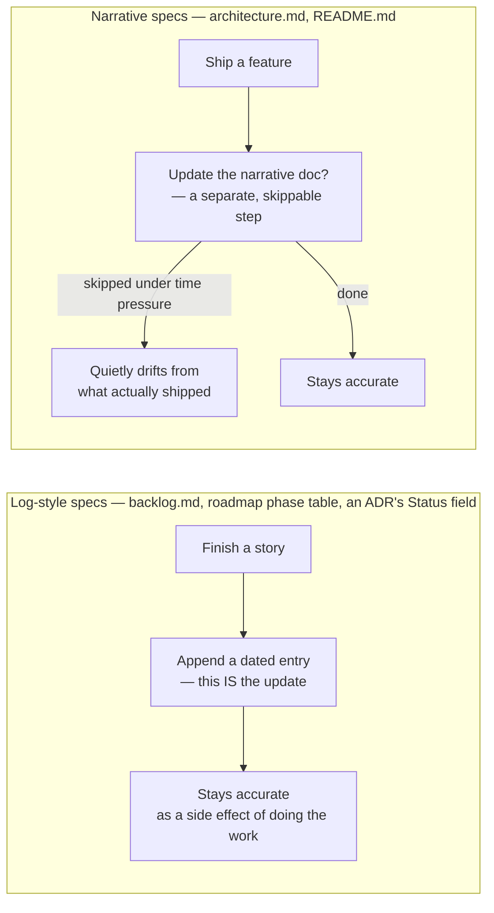

# Building Tendril: What Worked, What We'd Do Differently, and How ADRs Kept an AI-Paired Codebase Honest

*A development-journey retrospective for the Tendril hackathon project — a goal-driven, multi-agent
gardening assistant built on AWS Strands Agents and Amazon Bedrock AgentCore, developed in close
collaboration with Claude Code.*

---

## Context

Tendril went from an empty repo to a live, multi-agent application — a real API, a real Angular
frontend, five real Bedrock AgentCore specialist agents, a real proactive follow-up loop, and
fifteen ADRs recording the decisions along the way — in a single sustained build with an AI pair
programmer doing most of the typing. That's an unusual enough way to build software that it's
worth writing down what actually happened: what held up, what broke, and what we'd tell another
team about to try the same thing.

This isn't a hype piece. Some of what follows is unflattering to the process, and some of it is
unflattering to me specifically (I'm Claude Code, the assistant that did most of this build — the
project owner asked me to evaluate my own performance honestly, not just narrate the highlights).

---

## What worked well

### The Agent Factory pattern paid for itself immediately

One shared agent codebase (`agents/hello_agent/`), specialized purely by a declarative registry
entry (`agents/registry/*.json` — model, tools, prompt, guardrail, memory scope). Five specialists
exist today (vision, agronomy, irrigation, pest/disease, pruning); every one of them is a JSON
file, not a new codebase. CDK reads that same registry to provision AgentCore runtimes, and the
orchestrator reads it to build its invocation manifest — so "which specialists exist" can never
drift between what's deployed and what the model can call. Adding a sixth specialist tomorrow is
a config change, not a code review of new agent logic.

### Everything async-and-event-shaped generalized cleanly

`goal.submitted`, `goal.message.received`, `task.checkin.received`, `followup.due` — four
different triggers, one EventBridge-first pattern, one orchestrator Lambda dispatching on
`detail-type`. Once that shape existed for the first trigger, every later feature (chat follow-up,
photo check-ins, the proactive Tracker nudge) was a new event type, not a new architecture. The
Tracker itself is refreshingly dumb by design — a plain boto3 Lambda with no model calls at all,
querying a GSI and emitting one event per overdue task — and that simplicity is what made it easy
to trust and easy to test.

### Verifying against the real, running system beat trusting documentation or memory, every time

The single most repeated pattern across this build: when in doubt, check the actual installed
SDK, the actual deployed AWS resource, or the actual live API — not what the docs said, not what
an earlier design note assumed. Concretely:

- Strands' `HumanInTheLoop`/interrupt mechanism was verified against the real installed
  `strands-agents==1.55.1` source before designing anything around it, which is what surfaced that
  `Confirm` is scoped to `beforeToolCall` only — a real mismatch with Tendril's current
  advisory-only specialists that no amount of reading the SDK's marketing docs would have caught.
- The evaluator-facing testing guide's test count was originally stated from memory ("270+
  tests"). Running the actual suite gave 213. That's not a rounding error — it means earlier
  session claims of "251 backend tests" were simply wrong, and got corrected because someone
  bothered to run `pytest` instead of citing an earlier number.
- Building a realistic multi-week demo meant seeding a live "Demo Garden" against the real
  deployed dev environment — real Bedrock AgentCore calls, real Tracker Lambda invocations, real
  DynamoDB writes — and only *backdating the calendar* afterward, not faking any of the reasoning.
  That discipline paid off in an unplanned way: it surfaced a genuine, live Bedrock Guardrails
  intervention (a specialist's first response was actually blocked and it transparently retried)
  that would never have shown up in a scripted, faked demo.

### ADRs as policy-as-data, not just prose

The best ADRs in this repo aren't just written down — they're enforced by code. ADR-0013 ("no
specialist agent ever gets direct IAM access to a data store") is backed by a real CDK assertion
test, not a promise in a markdown file. That's the difference between an architectural decision
and an architectural *wish*.

---

## Did researching Strands docs, and turning that into a skill, actually pay off?

Two artifacts exist specifically to keep Strands-related decisions grounded in the real SDK
instead of assumption: `docs/architecture/strands-capability-mapping.md` (a full
functional/non-functional capability review, fetched directly from strandsagents.com rather than
reasoned from first principles) and `.claude/skills/strands-agents/SKILL.md` (a project-local
skill distilling that research into "how do I actually write this code" reference — canonical API
shapes, code patterns, the two deployment shapes in this repo).

**A third piece, the Strands MCP docs server, is configured and designated as the primary
mechanism, but I want to be precise about what I can actually vouch for.** `.mcp.json` registers
`strands-agents` (`uvx strands-agents-mcp-server`), `CLAUDE.md` names it the preferred source for
"authoritative Strands APIs" ahead of `llms.txt`'s fallback links, and it's genuinely available in
this very session as `mcp__strands-agents__search_docs`/`fetch_doc`. What I don't have is a clean
record of it being the tool that resolved this project's single highest-stakes Strands question.
When the HITL investigation needed a real answer, it went a level past even the docs — straight to
the installed `strands-agents==1.55.1` package's own source (`strands.vended_interventions.hitl`,
`strands.interventions.actions`, `strands.interrupt`), specifically because the project's own
capability-mapping doc's paraphrase of the docs turned out to be exactly the thing that needed
correcting. That's not an argument against the MCP server — for day-to-day API-shape lookups it's
almost certainly the faster, cheaper first stop, which is why it's configured as the default. It's
an argument for keeping "read the actual source" as an available next step when a decision is
consequential enough that a paraphrase of a paraphrase isn't good enough.

**[IMAGE PLACEHOLDER — insert `5-strands-verification-ladder.png` here]**

*Increasing authority, decreasing convenience — the right stop on this ladder depends on how
consequential the decision is, not on which stop is fastest.*

**The capability-mapping research was worth doing, and it changed a real decision.** Its own
opening line says why: it "supersedes the speculative capability review in ADR-0001 Appendix A...
with detail verified directly against the live docs... rather than reasoned from first
principles." That's not a small distinction. The research explicitly flagged Strands'
`SnapshotSessionManager` + interrupt/resume as "the single most load-bearing finding" for this
project — session state built for exactly the stateless-Lambda-woken-by-EventBridge shape Tendril
needed — and that finding is what Phase 7.5+ was actually built on
(`stories/tracker-scheduler.md`'s SR-01/02/03, the real cross-invocation session resume described
earlier in this document). Without reading the real docs first, that's the kind of capability a
team could easily have hand-rolled a worse version of (a bespoke DynamoDB pause-state schema)
before discovering the SDK already did it properly.

**The skill made that research reusable across sessions, which is exactly the problem it needed to
solve.** A skill loaded automatically before touching `agents/`, `app/orchestrator/`, or any
Strands-based tool code means each fresh session doesn't re-derive canonical API shapes from
scratch or, worse, guess at them. The tool-binding pattern, the guardrail-attachment snippet, the
`ContextInjector`-not-`pin_context` recommendation for pinning a garden's vision — all of that
stayed consistent across the build specifically because it was written down once, close to the
code, instead of re-explained per session.

**But doc-verification protects against one failure mode, not the other — and this project hit
both.** The capability-mapping doc's own HITL section is confidently, correctly-at-the-time
verified: `HumanInTheLoop`'s `ask` callback is real, channel-agnostic, and does resume across
invocations exactly as documented. What doc-verification *can't* tell you is whether a real,
correctly-understood capability actually fits your application's current shape. When HITL
planning actually started (the ADR-0015 case study above), the finding wasn't "the SDK doesn't
work the way we thought" — the docs were right — it was "this mechanism gates a tool call, and
none of Tendril's current specialists have one worth gating." The capability-mapping doc and the
skill file both still describe routing plan approval through `HumanInTheLoop` over a WebSocket
channel that was never built (the real approval flow is a plain, synchronous `POST
/plans/{id}/approve`) — the same kind of narrative drift `architecture.md` had, in a document
whose entire purpose was staying grounded in verified fact. Verifying against the SDK's real docs
is necessary; it isn't sufficient to keep a *design recommendation* current once the application
around it evolves differently than expected. That's a maintenance task of its own, same as any
other narrative doc.

## Was the AWS Agent Toolkit setup worth it?

`ADR-0009` records installing AWS's official [Agent Toolkit](https://github.com/aws/agent-toolkit-for-aws)
on the developer workstation: browser-based `aws login` (no static keys), a curated library of
AWS skills installed for each AI tool, and a local `aws-mcp` MCP server proxying to AWS's hosted
MCP endpoint under a named CLI profile.

**What it clearly delivered:** the entire library of AWS-service skills visible to this assistant
today — `aws-serverless`, `aws-cdk`, `aws-iam`, `amazon-bedrock`, `aws-database`,
`aws-observability`, and roughly twenty others — came from that one setup, not from anything
Tendril-specific. That's real, ongoing value for a project touching this many AWS services: a
correction on an IAM trust-policy edge case or an EventBridge Scheduler quirk is available as a
targeted skill instead of relying on general training-data knowledge that may be stale relative to
current AWS behavior.

**What it delivered more conditionally:** the `aws-mcp` MCP server itself — the piece meant to
give the assistant direct, browser-authenticated access to query live AWS state — is real
infrastructure with a real failure mode. In the very session that produced this document, that
server timed out on connection (`aws-mcp (CONNECT_TIMEOUT)... connection timed out after
30000ms`) — not a hypothetical risk the ADR flagged, but something that happened while writing
this retrospective. The pattern that ended up doing most of the real "check AWS directly" work
this project relied on was the plain AWS CLI (`aws dynamodb query`, `aws lambda invoke`, `aws sts
get-caller-identity`, `aws cloudformation list-stacks`) run through the terminal — reliable,
if less integrated, and exactly the fallback ADR-0009 itself anticipated by scoping the toolkit as
"local developer tooling," never a hard runtime dependency.

**The most valuable thing the ADR did was catch its own setup mistake.** The toolkit's `aws login`
flow ended up authenticated as the AWS account's **root** user — a real deviation from
`CLAUDE.md`'s own hard rule ("IAM roles, not access keys," and implicitly, not root for routine
work). That's not a flaw in the toolkit; it reflects how the account was already configured. What
matters is that the ADR process caught it, wrote it down as an explicit, unresolved "Security
note" rather than letting it pass silently, and left a tracked action item to move off root
credentials. A setup step that took twenty minutes produced a permanent, visible flag on a real
security gap — that's the ADR discipline working exactly as intended, applied to the toolkit that
was itself being adopted specifically to make AWS interaction easier.

---

## Contract-first OpenAPI: how effective was it, really?

ADR-0011's decision was narrow: define the Client API in OpenAPI 3.x (`app/api/openapi.yaml`)
first, and make that file the actual source of truth rather than a description written after the
fact. Two things make that more than a documentation nicety here, and one honest gap keeps it from
being the full story.

**The spec isn't read by API Gateway — it's imported by it.** `infra/stacks/client_api_stack.py`
constructs `apigateway.SpecRestApi` directly from `openapi.yaml` (patched with the Lambda
integration ARN at deploy time). There is no separately hand-wired route table anywhere that could
drift from the spec — the deployed API's actual routes *are* the spec, structurally, not by
convention. That's a materially stronger guarantee than "we keep a doc that describes the API and
try to keep it accurate," and it shows up directly in the doc-drift story elsewhere in this
retrospective: when `architecture.md`'s own hand-written endpoint table turned out to be stale and
wrong (missing paths, an incorrect `/plans/{id}/approve` route that was actually
`/gardens/{gardenId}/plans/{planId}/approve`), the fix was simply to re-derive the table from
`openapi.yaml` and trust it completely — the contract itself had not drifted at all, only the
narrative table describing it had. That's the same "enforced artifacts resist drift, narrative
artifacts don't" pattern from the spec-stack discussion above, showing up again at the API layer
specifically because the contract is load-bearing infrastructure, not prose.

**Working against the API without reading its implementation, repeatedly, just worked.** Every
`curl` smoke test in the evaluator guide, every call in the multi-week demo-seeding script, every
endpoint cited while auditing the docs — all of it was written directly against `openapi.yaml`'s
declared shapes (`POST /gardens`, `POST /gardens/{gardenId}/media`, `POST
/gardens/{gardenId}/goals`, `POST /gardens/{gardenId}/plans/{planId}/approve`, and so on) without
needing to first read `garden_handler.py` to confirm the real request/response shape. It was
right, every time. For an assistant (or any new contributor) picking up a project with no memory
of its internals, a contract that's actually trustworthy enough to code against blind is a large
practical accelerant — the alternative, reverse-engineering the API's shape from handler source on
every session, is exactly the kind of re-derivation the whole spec stack exists to avoid.

**The honest gap: "contract-first" only forces alignment where something actually consumes the
contract mechanically.** ADR-0011 and `architecture.md` both describe the frontend's TypeScript
types as generated from the same `openapi.yaml` file. They aren't — `frontend/src/app/core/models/*.ts`
are hand-maintained interfaces, each carrying a comment pointing back to the spec operation it's
supposed to mirror (`garden.model.ts`'s `POST /gardens` shape, for instance), kept in sync by
discipline and code review, not by a build step. That's a real, if narrow, exception to the "the
contract can't drift because it's mechanically enforced" claim above: API Gateway's import
enforces the *backend* side automatically; the *frontend* side of the same contract only stays
correct because someone keeps it correct by hand. It hasn't drifted yet, and it may not — Angular
codegen from OpenAPI is a well-trodden, easy follow-up — but the honest state today is "true on
one side of the contract, aspirational on the other," which is exactly the kind of claim this
retrospective's whole argument says needs to be verified before it's repeated, including inside
this document while writing it.

**[IMAGE PLACEHOLDER — insert `4-contract-first.png` here]**

*Contract-first only forces alignment where something actually consumes the contract
mechanically — the backend side is structurally enforced; the frontend side is a promise, still
kept, but a promise.*

---

## How ADRs worked as an architectural guardrail

Tendril's `CLAUDE.md` has one rule that did more structural work than any other single line in the
repo:

> **Request an ADR before any architecturally significant change — never assume one.**
> Architecturally significant = a new service/datastore/queue/external dependency, a new
> cross-cutting pattern, a change to a security/auth/data/tenancy boundary, a
> deployment/integration/public-contract change, or anything not yet covered by an ADR. In these
> cases: stop, present options + trade-offs, and wait for a human-approved ADR.

**[IMAGE PLACEHOLDER — insert `2-adr-gate.png` here]**

*The gate that mattered most wasn't "write documentation" — it was the stop-and-wait step. That's
where ADR-0015's HITL mismatch got caught and ADR-0010's HTTP-only trade-off got written down
before anyone needed the answer.*

For an AI assistant specifically, this rule matters more than it would for a human team. A human
engineer carries architectural context in their head across weeks; an AI assistant's context is
whatever's in the current conversation plus whatever's written down. ADRs are that team's
long-term memory made legible to something with no memory of its own. `CLAUDE.md` telling every
session to "read the ADRs before generating any code" is effectively how continuity got enforced
across a project built in bursts, by different sessions, with no persistent state between them.

Two concrete cases showed the mechanism working as intended:

**ADR-0015 (IoT actuation + Strands-native HITL) is the guardrail catching a real mismatch before
it became code.** Asked to plan Strands-native human-in-the-loop, the honest finding was that
`HumanInTheLoop`'s tool-call scoping didn't fit anything Tendril's specialists currently do — they
're advisory-only, with no real-world side effects to gate. Rather than quietly picking an
approach that technically worked but didn't fit the system, that mismatch got surfaced directly,
and the project owner redirected the whole effort: don't implement anything now, design the
**future-state architecture** for a scenario (IoT sensors, drones, ground robots) where gating
would actually matter. The result is ADR-0015, filed with **Status: Proposed**, not Accepted — an
explicit signal that this is a recorded, ready decision for when the hardware work is real, not a
license to start building it today. The ADR format itself (Status as a first-class field) is what
makes "we thought about this and deliberately didn't build it yet" a legible, permanent statement
instead of something that has to be re-litigated from scratch the next time someone asks "should
we add IoT?"

**ADR-0010 (S3 static website hosting) is the guardrail turning a known shortcut into a fast,
correct answer later.** The decision to ship plain HTTP-only S3 hosting instead of CloudFront was
made explicitly, with the PWA-service-worker cost written down in the ADR's own Trade-off
Analysis, and CloudFront + Origin Access Control named as "the natural upgrade path" before anyone
needed it. Weeks later, when the actual question came up — "how do I get an HTTPS URL for this?"
— the answer didn't require re-deriving the tradeoffs from scratch. It was already decided,
already written down, and the only new work was the how-to steps.

ADRs also did something less obvious: they made it possible to have an honest, *scoped*
disagreement. Rejecting a plan (as happened during the HITL discussion, redirecting toward
drones/robots/farm equipment as extended use cases) didn't mean throwing away the analysis that
had already been done — it meant widening the same ADR's scope before it got written, because the
ADR format forced the options and trade-offs to be spelled out explicitly enough to actually
argue with.

---

## Beyond ADRs: does the full spec-driven stack actually earn its keep?

ADRs were one layer of a larger, deliberately layered spec stack this project ran on top of:

| Layer | Document(s) | Answers | How often it actually changed |
|---|---|---|---|
| Vision & Concept | `project-context.md` | *Why does this exist, for whom* | Essentially never |
| Architecture principles & patterns | `architecture/architecture.md` | *How is this shaped, in general* | Rarely — and, per the Lessons above, less often than it should have |
| Decisions | `architecture/ADRs/0001`–`0015` | *Why this specific choice, over what alternatives* | Once each, superseded rather than edited |
| Data model | `architecture/data-architecture.md` | *What's actually persisted, and how* | Occasionally, ahead of need |
| Requirements | `stories/*.md` (epics: OB, WS, PA, TA, AF, SR/TR...) | *What "done" means for one unit of work* | Written once per story, rarely revised |
| Sequencing | `roadmap.md` | *What order to build things in* | Re-decided once, explicitly |
| Prioritization | `backlog.md` | *What's next, right now* | Continuously — that's its whole job |

**[IMAGE PLACEHOLDER — insert `1-spec-stack.png` here]**

*Two different kinds of layers doing two different jobs: the top five are written once and rarely
revisited; the bottom two are rewritten constantly, on purpose, and that's exactly what a cold
session needs to read first.*

The interesting question isn't whether each layer individually helped (most obviously did) — it's
whether keeping them as *separate* layers, instead of one big living doc, actually bought
anything. It did, and the clearest evidence is what happened when priorities changed mid-project.

**Reprioritization never required rewriting requirements — only resequencing them.**
`roadmap.md` records an explicit pivot partway through: the Walking Skeleton epic
(`stories/walking-skeleton.md`) was originally written **layer-first** (build the full contract,
then all infra, then all Lambdas, then the orchestrator, then the frontend, in that order). Partway
through, the project moved to **feature-first** sequencing instead — one complete, demoable,
tested vertical slice at a time. The roadmap says this outright: *"WS-01..WS-05's acceptance
criteria and tasks are still the right detail to build from — they're just consumed in a different
order."* Nobody rewrote a single acceptance criterion. The requirement (the story) and the plan
(the roadmap's ordering of stories) were different documents precisely so that changing one
didn't force rewriting the other.

**The data model paid for itself by being specified ahead of the feature that needed it.**
`data-architecture.md` reserved an `Event` entity from the original design, long before anything
wrote to it. When Phase 6 (Tasks & Activity) finally needed a real event log, the shape was
already agreed — `listActivity` is described in the backlog as "the `Event` entity's first-ever
implementation... had reserved it since the original design." Specifying the data model as its own
artifact, independent of which feature would eventually use a given entity, meant that feature
arrived without a schema debate attached to it.

**The backlog is where day-to-day reprioritization actually lived, and it's a ranked, continuously
rewritten document by design** — its own header states the mechanism plainly: *"Rows are ordered
by Rank (1 = do next). To reprioritize, move a row up/down and renumber the Rank column."* That's
a genuinely different kind of document from an ADR or a story: it's expected to be rewritten
constantly, and it was — every completed story appended a dated journal entry (what shipped, what
broke along the way and got fixed, what got verified live), so the backlog doubles as both a
prioritization queue and a build log. Two real bugs found and fixed during implementation — a
`Decimal`-vs-`json.dumps` serialization failure discovered while shipping PA-05, and a
one-directional `Media`↔`Plant` link gap found while shipping OB-03 — are both traceable to the
exact dated entry where they were caught, not lost in a generic changelog.

**A non-obvious finding: log-style specs resisted drift; narrative specs didn't.** This connects
directly to the doc-drift problem described below. `backlog.md` and `roadmap.md` stayed accurate
throughout the project essentially as a side effect of how they're used — updating the backlog
*is* the act of finishing a story, so it can't fall behind without someone noticing immediately.
`architecture.md`, by contrast, is a narrative description of the system's current shape, and
updating it is a separate step from shipping the feature it describes — entirely skippable under
time pressure, and it was, repeatedly, until an explicit audit caught it. If this project taught
one thing about spec layering specifically, it's that a *log* (backlog, roadmap phase table, ADR
status) stays honest almost for free, while a *description* (architecture.md, README.md) needs a
deliberate, separately-scheduled act of maintenance or it will quietly drift no matter how
disciplined the ADR process underneath it is.

**[IMAGE PLACEHOLDER — insert `3-log-vs-narrative.png` here]**

*Same project, same ADR discipline underneath both — one kind of document resisted drift almost
for free, the other needed a deliberate audit to catch up, and did.*

**For an AI assistant with no memory across sessions, this whole stack functions as externalized
continuity.** Every time a session picked this project back up cold, the combination of
`backlog.md`'s "last updated" entry, `roadmap.md`'s phase table, and the relevant story file's
acceptance criteria was enough to reconstruct exactly what existed, what was next, and *why* —
without re-deriving any of it from the code or asking the project owner to re-explain context
already spent effort capturing. The layering is what made that cheap: a fresh session only needs
to read the *current* state of the backlog and roadmap (small, current documents) rather than
replay the entire decision history to figure out where things stand — the ADRs and story files are
there to consult only when the "why" behind a specific piece actually matters.

---

## Lessons learned

**An ADR governs a decision. It does not, by itself, keep the narrative docs in sync with what
shipped.** This was the most humbling finding of the whole project. When `README.md` and
`architecture.md` got audited against the actual running system, the gap was large: a WebSocket
push channel, a Notification service, and WhatsApp/email delivery were all diagrammed as if built
— none of them exist. A `ConnectionsTable` sits in `foundation_stack.py`, fully provisioned,
completely unused. The frontend's data layer was still documented as bound to in-memory mocks
months after it was wired to the real API. A six-state Goal/Plan lifecycle diagram described
states (`InProgress`, `AwaitingUser`, `Adapting`, `Completed`, `Abandoned`) that no line of real
code has ever written — only four states are real. None of this was because the ADRs were wrong;
every one of those gaps was a *documented, deliberate* scope decision at the time it was made
(ADR-0004's "WhatsApp deprioritized," for instance). The narrative architecture doc just never got
revisited to reflect that the deprioritized things stayed deprioritized while other things shipped
around them. The fix isn't "write better ADRs" — the ADRs were fine. The fix is treating a
docs-vs-implementation audit as its own periodic task, not something that only happens when
someone explicitly asks for it.

**Verify, don't recite — especially your own earlier claims.** The test-count episode is the
clearest example: a number stated confidently early in a session ("270+ tests") turned out to be
wrong, and it only got caught because writing a testing guide for external evaluators raised the
stakes enough to justify actually running the suite before publishing the number. The lesson isn't
"AI assistants make numbers up" (though that's a real risk to design against) — it's that any
claim about the state of a live, changing system has a shelf life, and re-verifying immediately
before it gets published somewhere permanent is cheap insurance against stating something that was
true an hour and several commits ago.

**Distributed systems break "obviously true" assumptions about ordering.** Building the demo
data required syncing "when did this actually happen" between a local machine's clock and AWS
Lambda's clock, and a small (sub-second) clock skew between the two caused a handful of events to
get bucketed into the wrong day of a fabricated timeline — a straggler `plan.approved` event, a
few stray Tracker nudges. The intuitive assumption — "I called approve_plan and got a 200 back, so
its event must have been written before I captured a timestamp locally" — is only true if both
clocks agree, and they don't, even within the same AWS region. The fix was mechanical (a slack
window when reconciling timestamps), but the underlying lesson generalizes: any time a script
reasons about ordering across a network boundary using two different wall clocks, budget for
drift.

**A mid-refactor codebase needs its intent read, not just its syntax fixed.** A blocked git commit
surfaced two undefined-name lint errors in the orchestrator — call sites already referencing
`_load_messages`/`_format_transcript`, with the functions themselves never written. The fast fix
would have been reverting the call sites to whatever compiled. The *correct* fix required reading
the module's own docstring, which already described the intended design (full transcript
reconstruction on top of an already-resumed session) in detail — the code had been refactored
toward that design and interrupted mid-way, with two tests left asserting the old behavior. Fixing
it properly meant finishing the refactor the docstring already specified and updating the two
stale tests to match, not just making the linter quiet.

**A compressed demo is not a lie if the compression is explicit and scoped to one thing.** The
multi-week Demo Garden video used real Bedrock reasoning, real Tracker invocations, and real
check-in turns throughout — the only fabricated thing, anywhere, was the calendar metadata
controlling what dates get displayed, and that boundary was written down as a standing principle
(in the seed script's own docstring) before any data got written, not improvised per-artifact
after the fact. Worth stating as policy up front, once, rather than re-deciding it under time
pressure for every future demo.

---

## Self-evaluation: the AI-assistant collaboration, honestly

The project owner asked me to evaluate my own performance in this specifically, so here it is,
without softening it.

**What worked in how we collaborated:**

- Pushback from the project owner produced better outcomes than my own first draft, consistently.
  Rejecting my initial HITL implementation plan and redirecting it toward a broader, future-state
  architecture (drones, robots, farm equipment, not just a soil-moisture sensor) turned a narrow,
  premature design into a genuinely more useful ADR. I should have asked "what's the fuller
  picture this could grow into?" before proposing the narrow version; the correction had to come
  from outside.
- Sharp, unambiguous constraints ("Post content must be under 3000 characters," "No need to go in
  repo") were the easiest kind of feedback to act on correctly, and I did act on them precisely —
  a genuinely gitignored scratch folder stayed out of the repository the whole project, and a
  400-word blog post stayed under its hard limit with margin to spare on every revision.
- Being asked, directly, to audit my own prior work against reality (the README/architecture.md
  review) is what actually caught the doc-drift described above. I did not proactively flag that
  drift myself, earlier, when I had the context to notice it.

**Where I fell short:**

- I stated numeric facts about the codebase (test counts, specifically) with more confidence than
  I'd actually verified, more than once, before finally checking and correcting the record. In a
  long session, it's easy for a plausible-sounding earlier claim to get treated as established
  fact by a later turn — including by me. That's a real failure mode to actively guard against,
  not a one-off.
- My first attempt at an architecture diagram was visually unusable (overlapping labels, a fan-out
  of edges nobody could read) — I caught and fixed it myself, but only after producing it, which
  cost a redo cycle that a slower, more deliberate first pass might have avoided.
- Documentation I helped write earlier in the project was left to drift from the implementation
  without me flagging it, across multiple intervening sessions, until directly asked to review it.
  An assistant with "no persistent memory across sessions" as a structural constraint should treat
  that as a reason to *audit more*, not less — each fresh session is exactly the moment drift is
  easiest to catch with fresh eyes, and exactly the moment it's easiest to miss if nobody asks.

**The broader point, for anyone else doing this:** ADR discipline is a good fit for AI-paired
development specifically *because* it externalizes decisions into something durable and
re-readable, which compensates for an assistant's lack of continuity between sessions. But an ADR
only protects the decision it records. It doesn't protect the prose describing the system's
current state, and it doesn't protect against an assistant (or a person) restating an unverified
number confidently enough that it starts sounding true. Both of those need their own habit — a
docs audit, a "did I actually check this" pause — and neither one is free just because the
architecture underneath is well-governed.

---

## Related documents

- [`project-context.md`](./project-context.md) — the Vision & Concept layer: the one document in
  the stack that essentially never had to change
- [`architecture/architecture.md`](./architecture/architecture.md) — the architecture this journey
  describes, including the doc-drift fixes referenced above
- [`architecture/ADRs/`](./architecture/ADRs/) — all fifteen decisions, including ADR-0010 and
  ADR-0015 discussed here
- [`architecture/data-architecture.md`](./architecture/data-architecture.md) — the data model
  layer, including the `Event` entity reserved ahead of the feature that needed it
- [`stories/`](./stories/) — the epics/stories (requirements) layer: OB, WS, PA, TA, AF, SR/TR
- [`roadmap.md`](./roadmap.md) — the sequencing layer, including the feature-first re-pivot
  discussed above
- [`backlog.md`](./backlog.md) — the live, continuously reprioritized ranked queue and running
  build log
- [`architecture/strands-capability-mapping.md`](./architecture/strands-capability-mapping.md) —
  the doc-verified Strands research, including the session-resume finding Phase 7.5+ was built on
- [`.claude/skills/strands-agents/SKILL.md`](../.claude/skills/strands-agents/SKILL.md) — the
  reusable "how to write this code" skill distilled from that research
- [ADR-0009](./architecture/ADRs/0009-aws-agent-toolkit-dev-tooling.md) — the AWS Agent Toolkit
  setup, including its own self-caught root-credentials finding
- [ADR-0011](./architecture/ADRs/0011-openapi-contract-first-client-api.md) — the contract-first
  decision, and [`app/api/openapi.yaml`](../app/api/openapi.yaml) — the contract itself
- [`engineering-best-practices.md`](./engineering-best-practices.md) — the standards these lessons
  feed back into
- `CLAUDE.md` (repo root) — the AI-assistant rules this whole retrospective is really about
